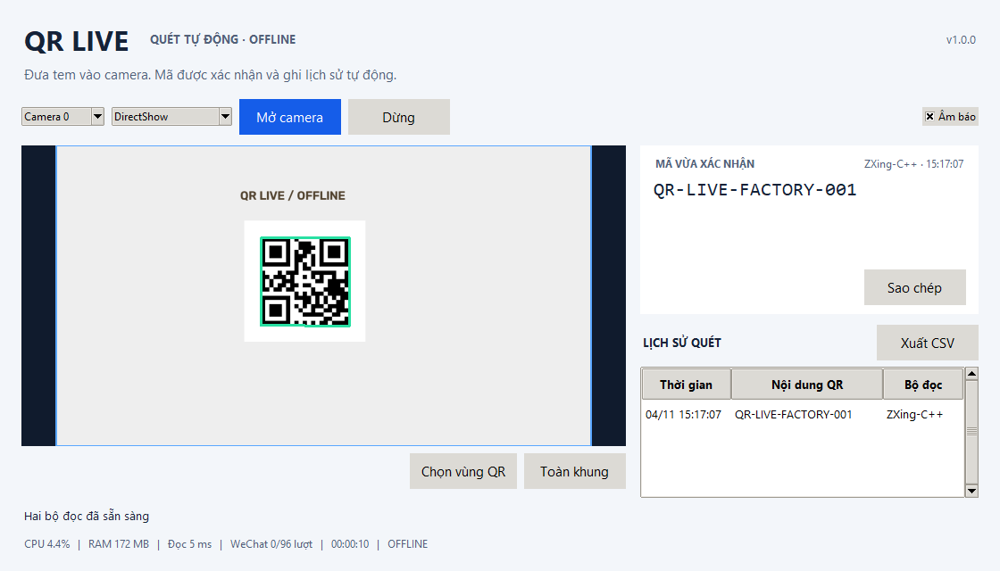

# QR Live Scanner

Ứng dụng Windows độc lập quét QR trực tiếp từ camera bằng **ZXing-C++ +
OpenCV WeChatQRCode**, chạy offline. Không cần bấm chụp, API key hoặc cài Python.
Đây là ứng dụng chỉ quét QR, không có phần cân, kho hoặc đồng bộ cloud.

**[Tải bộ cài Windows](https://github.com/huybitvvt/qr-live-scanner/releases/latest/download/QRLiveScanner-Setup.exe)** ·
[Hướng dẫn sử dụng](HUONG-DAN.md) · [Các bản phát hành](https://github.com/huybitvvt/qr-live-scanner/releases)



## Sử dụng

Cài bộ cài và mở **QR Live Scanner**. Ứng dụng tự mở Camera 0 và quét ngay.
Nếu chọn sai camera, đổi Camera 0–9 rồi bấm **Mở camera**. Có hai driver
DirectShow và Media Foundation. Kéo chọn vùng tem bằng **Chọn vùng QR** nếu
khung hình có nhiều tem hoặc tem nhỏ. **Toàn khung** khôi phục vùng quét.

Mã được xác nhận qua hai frame, tự ghi lịch sử local và phát âm báo.
Giữ nguyên mã trong camera không tạo thêm dòng liên tục. Đưa mã ra khỏi vùng
quét trên 1,5 giây rồi đưa lại sẽ ghi một lần mới. Mở lại ứng dụng/nguồn tạo
phiên quét mới. Có **Sao chép**, nhấp đúp dòng lịch sử và **Xuất CSV**.
Chỉ hiển thị/lưu nội dung QR; không tự mở URL hoặc thực thi nội dung.

## Thiết kế vận hành liên tục

- Camera native và bộ giải mã ở hai tiến trình riêng; giao diện không sở hữu camera.
- Camera yêu cầu 1280×720/30 FPS; độ phân giải/FPS thực tế phụ thuộc thiết bị.
- Chỉ một frame mới nhất trong bộ nhớ dùng chung, không xếp hàng ảnh.
- ZXing quét tối đa 10 lần/giây, chỉ định dạng QR; giữ pixel gốc trong vùng chọn.
- WeChat tối đa 1 lần/giây khi có hoạt động; cảnh đứng yên giảm xuống 1 lần/5 giây.
  Khi đọc được QR, giữ nhịp đủ để xác nhận. Model nạp một lần cho mỗi tiến trình.
- OpenCV một thread trong mỗi tiến trình. Quá tải sẽ bỏ frame, không dồn độ trễ.
- Bỏ kết quả từ frame cũ hơn 2,5 giây; watchdog phục hồi worker/camera treo.
  Sau 3 lần phục hồi trong một phút sẽ dừng và yêu cầu kiểm tra camera.
- Không lưu ảnh/video xem live; log xoay tối đa khoảng 4 MB.
- Lịch sử SQLite giữ tối đa khoảng 100.000 lượt/90 ngày, dọn mỗi 100 lượt hoặc
  mỗi giờ. Giao diện giữ 200 dòng gần nhất. CSV xuất toàn bộ lịch sử đang giữ.
- Không gọi mạng lúc sử dụng. Model có sẵn trong bộ cài, xác minh SHA-256 khi nạp.

Dữ liệu nằm tại `%LOCALAPPDATA%\QRLiveScanner`, tách biệt ứng dụng trạm cân.
Gỡ/cài đè không xóa lịch sử hay cấu hình. Windows không được sleep khi cần quét.
Ứng dụng không đặt lịch tự restart Windows và không tự thay đổi power plan.

## Phát triển và build

Windows 10/11 x64, Python 3.14 x64; Inno Setup 6 để tạo installer.

```powershell
python -m venv .venv
.venv\Scripts\python.exe -m pip install -r requirements-build.txt
.venv\Scripts\python.exe tools\fetch_models.py
.venv\Scripts\python.exe -m pytest
.venv\Scripts\python.exe -m qr_live
powershell -NoProfile -ExecutionPolicy Bypass -File tools\build_windows.ps1
```

`requirements-lock.txt` ghi toàn bộ phiên bản môi trường build đã kiểm chứng.

Ghim OpenCV 4.13 vì API WeChat sử dụng bốn file Caffe. OpenCV 5 thay đổi API
khởi tạo và không tương thích trực tiếp với bốn file này. Không cài đồng thời
nhiều bản `opencv-python`/`opencv-contrib-python` trong môi trường build.

Đầu ra: `dist/installer/QRLiveScanner-Setup-1.0.0.exe` và `SHA256SUMS.txt`.
Mã nguồn có giấy phép MIT. Xem [thành phần bên thứ ba](THIRD-PARTY-NOTICES.md).
Phiên bản, giới hạn kiểm chứng và kết quả thực tế ở [VALIDATION.md](VALIDATION.md).

## Giới hạn

Độ đúng/tốc độ phụ thuộc kích thước tem, lấy nét, ánh sáng và CPU. Tem cong,
lóa hoặc nhòe mạnh vẫn có thể không đọc được. Hai frame cùng kết quả không
chứng minh tem đã được chọn đúng khi có nhiều QR trong vùng quét.
Đây là bộ cài dành để chạy thử tại xưởng; không công bố đã nghiệm thu 24/72 giờ.
